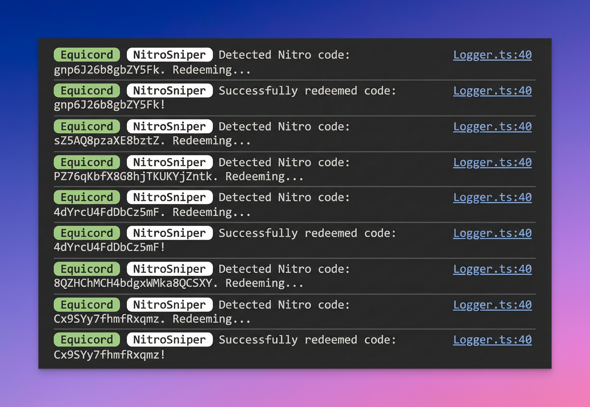

# NitroSniper

A Vencord/Equicord plugin to auto snipe nitro gift codes, with multi user token support.

|  |
| :---: |
| This isn't even the full screenshot. See [here](assets/full.png) |

## How fast is it

The claim fires the instant a gift link arrives. There is no artificial delay, no cooldown, and no waiting between detection and redeem. What you end up seeing in the logs and in webhook embeds is the full round trip:

| Stage | Typical time |
| --- | --- |
| Message arrives, code extracted, filters checked | under 5 ms |
| Redeem request sent to Discord | network round trip, about 150 to 400 ms |
| Discord processes the redeem | 500 to 1500 ms on their side |
| **Total, detection to claimed** | **roughly 700 to 2000 ms** |

Your observed times will sit around 2 to 3 seconds on a normal connection, and most of that is Discord's own processing time, not the plugin. The `Delay` field in each webhook embed shows the exact number for every claim. Redeem requests time out at 15 seconds, and Discord's own redeem popup at 20 seconds, so a hung request can never freeze the queue.

Winning a snipe comes down to your ping to Discord's servers and how fresh your token session is. If someone else's sniper claims first, you will see `already redeemed` in the failure embed. That is the code being gone, not the plugin being slow.

## Features

| Feature | What it does |
| --- | --- |
| Auto snipe | Claims gift codes the moment they're posted, no delay |
| Multi token | Alt accounts listen and claim through their own gateway connections |
| Redeem strategies | Current account first, alts first, alts only, race, or current only |
| Blacklists / whitelists | Right-click any server, channel, or DM to block or allow it |
| Duplicate protection | The same code posted ten times gets claimed once |
| Multi link messages | A message with three different links claims all three, once each |
| Claim stats | Lifetime tally with hit rate, per-account wins, last claim time |
| Webhook notifications | Claim and failure embeds sent to your webhook |
| Skip reasons visible | Filtered or skipped codes tell you why, in a toast and the console |

## Installation

1. Install [Vencord](https://docs.vencord.dev/installing/) or [Equicord](https://github.com/Equicord/Equicord)
2. Clone this repo into the `src/userplugins` folder of your client mod
3. Build and inject, then enable NitroSniper in settings

## Usage

The plugin runs the moment it's enabled. It watches every channel your accounts can see, and claims any nitro gift link posted in them.

**Tokens:** Settings → NitroSniper → Token Manager. Paste alt tokens one at a time or in bulk. Enabled tokens listen in real time and can claim codes depending on your chosen strategy. Tokens are stored locally in your settings and never leave your machine except to Discord itself.

**Strategies:**
- *Current Account First, then Alts*: your logged-in account tries first, then each alt in order
- *Alts First, then Current Account*: alts try first, your account is the fallback
- *Alts Only*: only alt tokens claim, your account just watches
- *Race*: every account fires at the same time, first success wins
- *Current Account Only*: alts only listen and report, they never claim

**Blocking locations:** Right-click a server, channel, thread, DM, or group DM and pick Sniper: Blacklist / Whitelist. Blacklists always win over whitelists. All whitelists empty means claim everywhere. If any whitelist has an entry, claiming is restricted to whitelisted locations only, and everything else gets skipped with a visible reason.

**Duplicate links:** Each gift code gets claimed exactly once per session, no matter how many times or in how many channels it appears. When duplicate codes are ignored, the console shows `Ignoring duplicate gift code`.

**Stats:** Settings → NitroSniper → Claim Stats. Shows your lifetime numbers, hit rate, a leaderboard of which account claims the most, and when your last claim landed. Stats persist across restarts. The reset button clears the tally.

**Webhooks:** Paste a Discord webhook URL in settings to get an embed on every attempt. Embeds include the code, sender, server, channel, message link, the delay in milliseconds, which account claimed it, and your running lifetime tally in the footer.

**Testing your setup:** Links you send from your own account are skipped when `Skip gift links sent by you` is on. To test, turn that setting off or send the link from a different account. Every skip shows the reason in a toast and in the console (Ctrl+Shift+I, filter for NitroSniper).

**Captcha behavior:** Claims through your logged-in account use Discord's own redeem flow and rarely challenge you. Claims through raw alt tokens can trigger a captcha prompt depending on the account's age, IP, and claim history. This plugin does not solve captchas. If you get challenged, solve it manually. For fewer challenges, use aged alt accounts and the Current Account strategies.

## How claiming works

When a message arrives, the plugin extracts every gift code from it, checks each one against your blacklists and whitelists, skips codes it has already seen this session, and queues the rest. The queue claims one code at a time through your chosen strategy. If a code is already claimed by someone else, the sequence stops instead of wasting your other tokens on it. The current account path uses Discord's own redeem action, so it looks like a normal click from your client. Alt token claims go through the main process with your client's real headers attached, so they do not stand out as bare API calls.

## Troubleshooting

| Symptom | Cause and fix |
| --- | --- |
| Links detected but not claimed | Check the console for the exact reason. Your own links are skipped when ignore-own is on. Blacklisted locations are skipped with a toast. |
| `already redeemed` embeds | Someone else claimed the code first. Normal in busy sniping channels. |
| Failure embed with `Invalid gift code` | The code was fake or expired bait. Nothing to fix. |
| Failure embed with `already has subscription` | The claiming account already has nitro. Try a different strategy or account. |
| Captcha prompt on token claims | The alt account's risk score is high. Use an aged account or the current account strategy. |
| Stats not updating live | Stats refresh on each claim. Reopen the settings panel if it looks stale. |

> [!CAUTION]
> **Use at your own risk**
>
> This plugin is against Discord's Terms of Service and can get you banned. In addition to that, Vencord does not in any way endorse this plugin. This is usermade and you will have to follow [Vencord's Installation Method](https://docs.vencord.dev/installing/) to build and install this plugin.

## Credits

- [neoarz](https://github.com/neoarz) — original creator of the NitroSniper Equicord plugin
- [Vencord](https://github.com/vencord/vencord)
- [Equicord](https://github.com/Equicord/Equicord) (The fork im currently using)
- [Discord](https://discord.com) for putting captcha on token based sniping inspiring me to make this :D

## License

This project is licensed under the MIT License - see the [LICENSE](LICENSE) file for details

## Support

Make a github issue if you find any bugs or have any questions or preferably dm me on discord `neoarz`.
 
If you find this project useful, consider leaving a star, would mean alot!! ❤️
