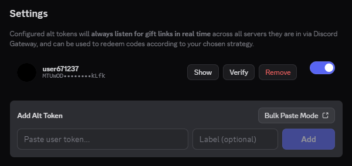

# NitroSniper

A simple Vencord/Equicord plugin to auto snipe nitro gift codes, with multi user token support.

|                                                                             |
| :--------------------------------------------------------------------------------------------------: |
| This isn't even the full screenshot. See [here](https://github.com/neoarz/NitroSniper/blob/main/assets/full.png) |

|                                                                        |
| :--------------------------------------------------------------------------------------------------: |
| There is also Bulk Paste Mode. See [here](https://github.com/aboveproof/NitroSniper/blob/main/assets/bulktokenpaste.png) |

> [!CAUTION]
> **Use at your own risk**
> 
> This plugin is against Discord's Terms of Service and can get you banned. In addition to that, Vencord does not in any way endorse this plugin. This is usermade and you will have to follow [Vencord's Installation Method](https://docs.vencord.dev/installing/) to build and install this plugin.

## Credits
- [Vencord](https://github.com/vencord/vencord)
- [Equicord](https://github.com/Equicord/Equicord) (The fork im currently using)
- [Discord](https://discord.com) for putting captcha on token based sniping inspiring me to make this :D
- [Neoarz](https://github.com/neoarz/NitroSniper) The original creator of the Nitro Sniper equicord plugin.

## License
This project is licensed under the MIT License - see the [LICENSE](LICENSE) file for details

## Support
Make a github issue if you find any bugs or have any questions or preferably dm me on discord `neoarz`.
 
If you find this project useful, consider leaving a star, would mean alot!! ❤️
